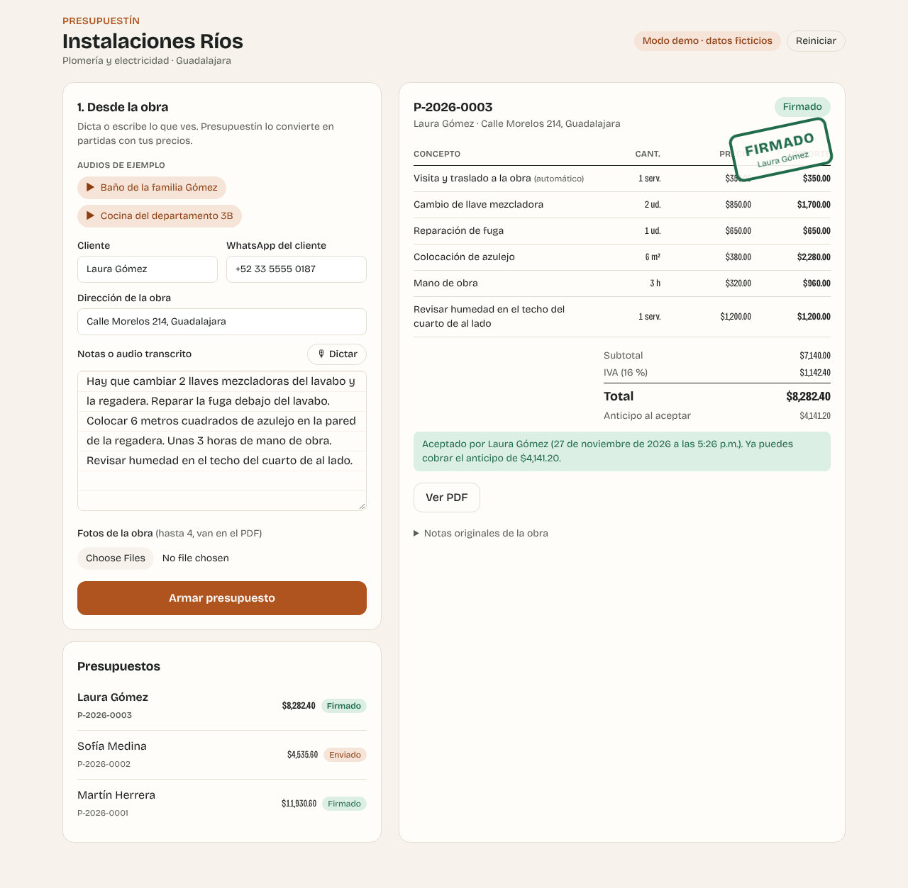
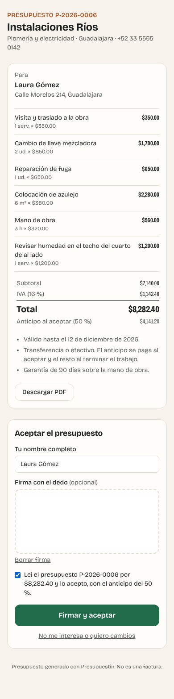
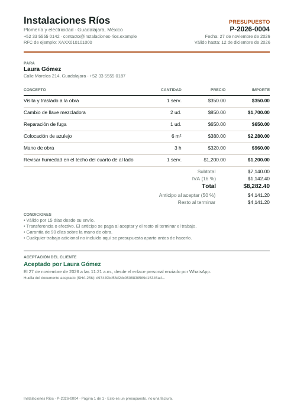

# Presupuestín

De las notas, audios y fotos de la obra a un presupuesto en PDF que tu cliente firma desde WhatsApp.
Cuarta demo de la Fábrica de software para pymes de Latinoamérica (autónomos de oficios).



## Qué hace
1. **Desde la obra**: dictas o escribes lo que ves ("cambiar 2 llaves mezcladoras, 6 m2 de azulejo, 3 horas de mano de
   obra") y añades fotos.
2. **Armar presupuesto**: el intérprete lo convierte en partidas con tus precios de catálogo. Lo que no reconoce queda
   marcado "por definir": Presupuestín no inventa precios.
3. **Enviar por WhatsApp**: mensaje listo y enlace personal para el cliente; lo envías tú desde tu teléfono.
4. **El cliente firma** desde el móvil (nombre + firma con el dedo) y tu panel se sella como FIRMADO al instante.
5. **PDF** con tus datos, fotos de la obra, totales con IVA, anticipo y la constancia de aceptación con huella SHA-256.

| Cliente en el móvil | PDF firmado |
|---|---|
|  |  |

## Probarlo
```bash
npm install
npm run dev        # http://localhost:3000, modo demo sin claves
npm test           # 40 tests
```
En el panel: toca **Baño de la familia Gómez** → **Armar presupuesto** → pon precio a la línea marcada → **Guardar** →
**Enviar por WhatsApp** → **Abrir como el cliente (demo)** → firma. Vuelve al panel: se sella solo.

Variables opcionales en `.env.example` (`PRESUPUESTIN_TOKEN` cierra el panel con clave).

## Adaptarlo a otro autónomo
Todo está en `src/presupuestin/config.ts`: datos del negocio, moneda, impuesto, condiciones y catálogo con los
sinónimos con que el autónomo nombra cada partida.

## Guion del vídeo de 60 s
1. (0–10 s) Plano del móvil en una obra: "Esto me llevaba una noche entera".
2. (10–25 s) Toco el audio de ejemplo; las notas aparecen solas. "Armar presupuesto": líneas con precios y una marcada
   "por definir". Le pongo precio.
3. (25–35 s) "Enviar por WhatsApp": se abre el mensaje con el enlace.
4. (35–50 s) En el móvil del cliente: revisa, firma con el dedo, "Firmar y aceptar".
5. (50–60 s) Vuelvo al panel: el sello FIRMADO cae sobre el presupuesto. Abro el PDF firmado. "De la obra al sí del
   cliente en dos minutos".

## Documentación
`ALCANCE.md` (alcance y decisiones), `AUDITORIA.md` (seguridad y calidad), `STATUS.md` (estado y pendientes),
`CLAUDE.md` (arquitectura y convenciones).
